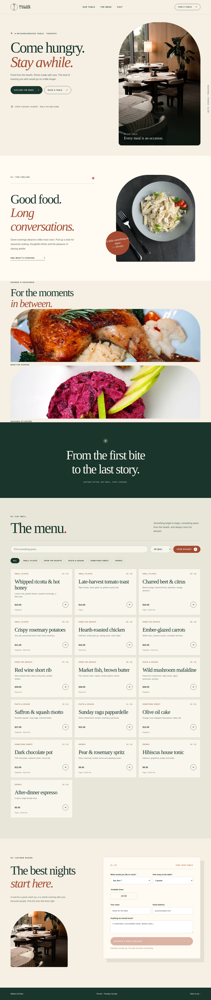
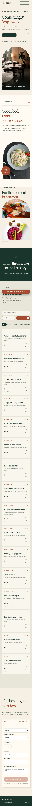

# Mallow & Ember

[](https://nextjs.org/) [](https://www.typescriptlang.org/) [](https://miladmo68.github.io/mallow-ember-kitchen/)

**[Live Demo](https://miladmo68.github.io/mallow-ember-kitchen/)** · **[Source repository](https://github.com/miladmo68/mallow-ember-kitchen)**

An original, editorial restaurant experience for a fictional Toronto neighbourhood table. It pairs a fully searchable seasonal menu with a pickup-order preview and a capacity-aware table-reservation planner. The interface uses warm paper, forest green and terracotta, generous typography, and carefully credited food photography.



## What works

- Browse 16 detailed menu items, search by name or description, filter by course and dietary preference.
- Build a basket with quantity changes, automatic 13% HST calculations and local persistence.
- Complete a validated pickup-order **preview**, select an available time, view saved previews and add an order again.
- Choose a date, party size and time using capacity-aware tables; submit, review and cancel reservation **previews**.
- Use the complete experience at desktop and phone widths, with keyboard-accessible controls, focus indication, reduced-motion support, and useful empty/error states.

The menu, availability, orders and reservations are illustrative. Preview actions remain in your browser; no restaurant receives them, no table is actually reserved, and no payment is taken.

## Technologies and architecture

Next.js App Router, React, TypeScript, semantic HTML, original responsive CSS, browser localStorage, Playwright, Node.js tests, GitHub Actions and GitHub Pages. The static export contains no server, paid database or secrets. Domain rules for pricing, pickup windows, table capacity and overlapping reservations are separated from UI components. All dependencies are pinned exactly.

## Run and validate

Requires Node.js 22.

```bash
npm ci
npm run dev
npm run validate
npx playwright install chromium
npm run qa:browser
```

`validate` runs ESLint, TypeScript, domain tests and a production build. `qa:browser` tests the built static output in Chromium at desktop and phone viewports and generates the two screenshots above. The deploy workflow runs the same checks and publishes the static output to GitHub Pages.

## Image attribution

Editorial photographs are individually credited in [PHOTO_CREDITS.md](PHOTO_CREDITS.md). They illustrate the fictional brand and are not photos of an operating restaurant. The screenshots above are genuine captures of this application.
